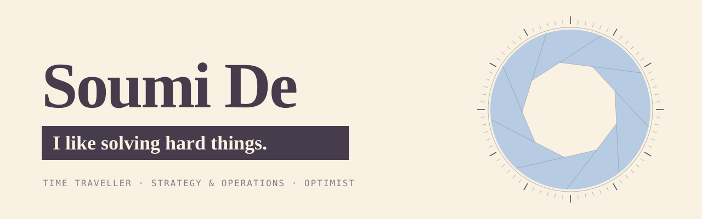

  

**Strategy and Operations at Handshake.** Before that, Head of Growth at Mercor, where I joined as the first operations hire, back when it had no revenue.

I was in human data before it was sexy. Most of my time goes into starting things: a new line of business, a team that doesn't exist yet. I get it working, then scale it or hand it to someone who'll run it well.

### Quoted in

- **Forbes** · [Powering Talent Recruitment With AI](https://www.forbes.com/sites/johnwerner/2025/05/27/powering-talent-recruitment-with-ai/) (May 2025)
- **The Economic Times** · [Indian roots of a $2-bn Silicon Valley platform](https://drive.google.com/file/d/1Bj3C3zonnPaHv4AIFsNlS98uR-JjWkzZ/view?usp=sharing)

### Off the clock

1,200+ films and shows watched, every one rated for a friend. Kolkata biryani, with the potato. Diet Coke on the side.

---

**Say hi on [LinkedIn](https://www.linkedin.com/in/soumizde) or [X](https://x.com/soumizde).** The rest of the story is at [soumizde.github.io](https://soumizde.github.io).
